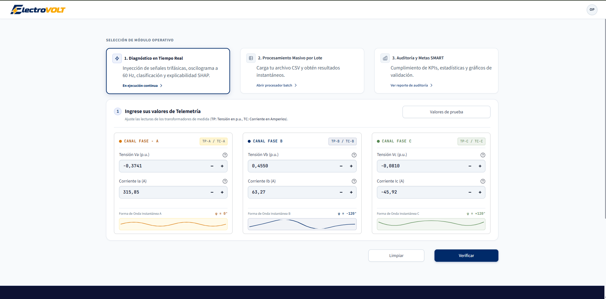
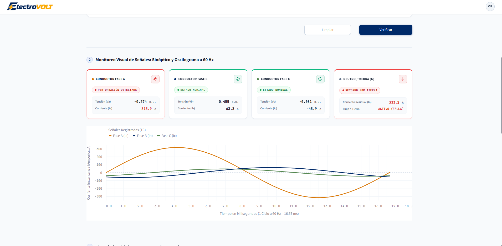
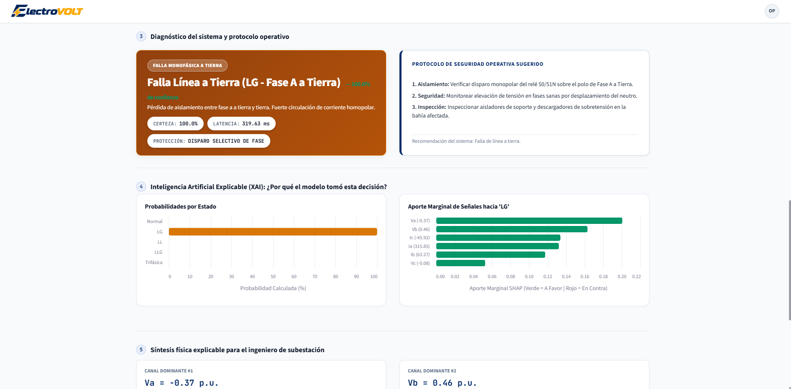
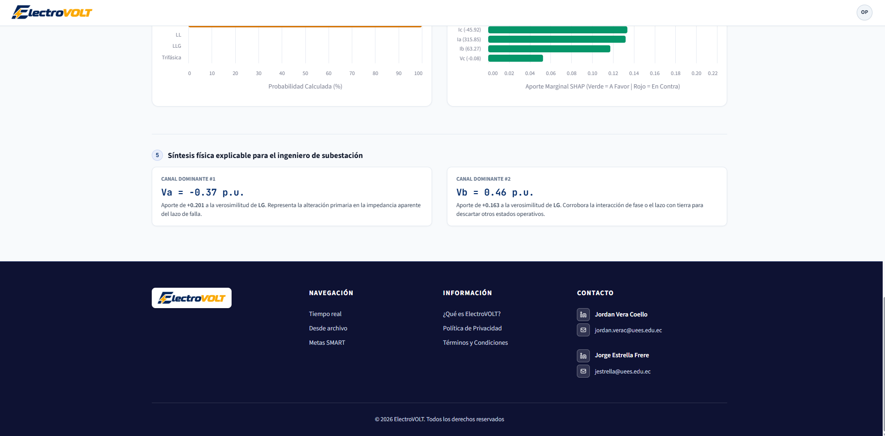
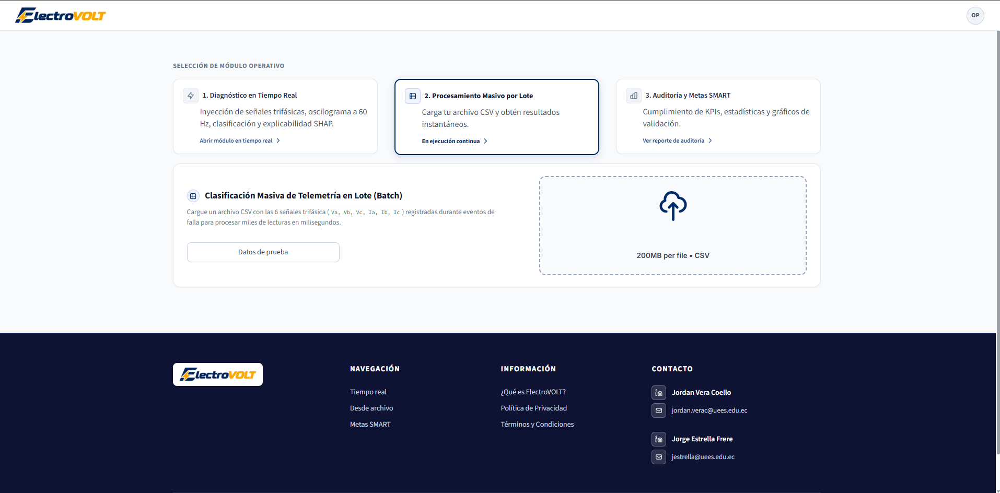
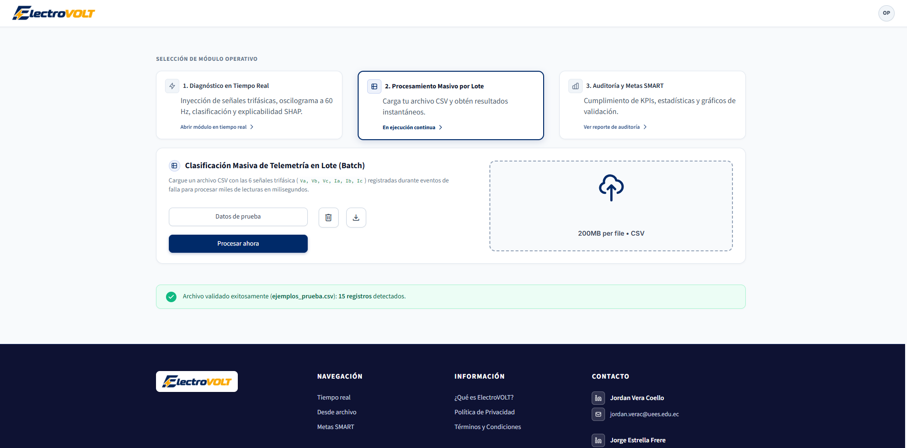
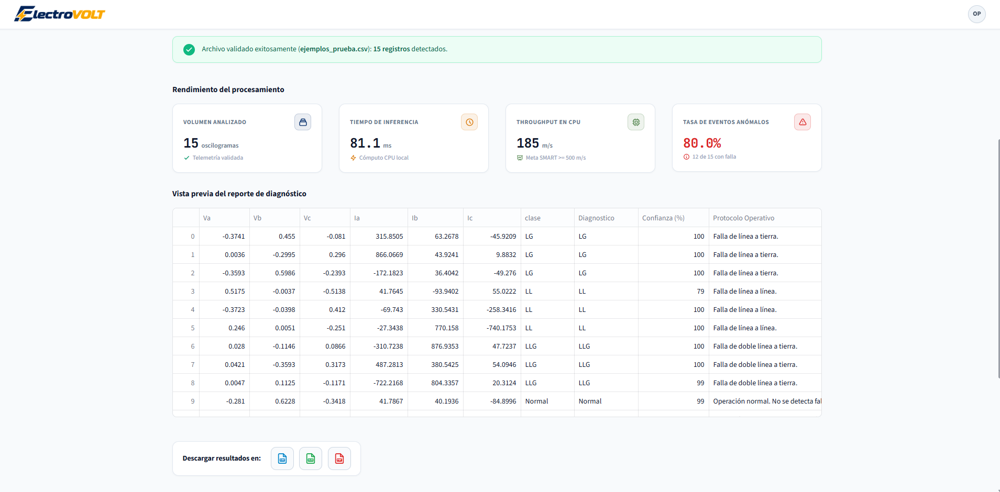
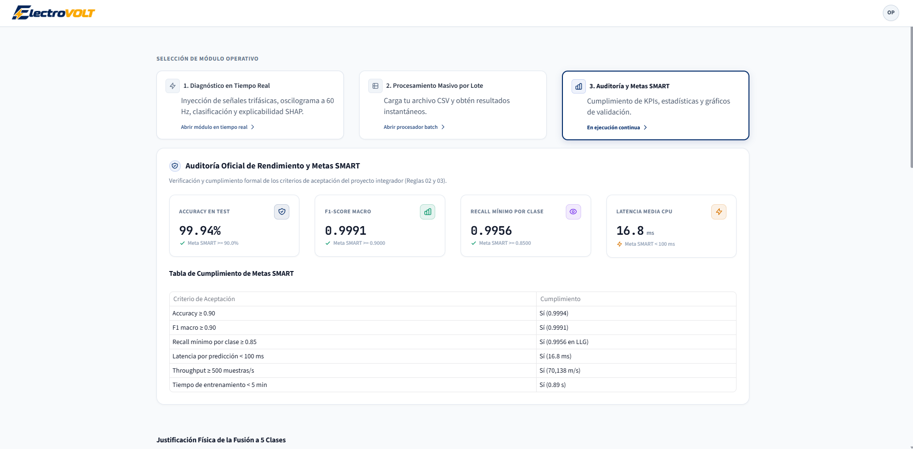
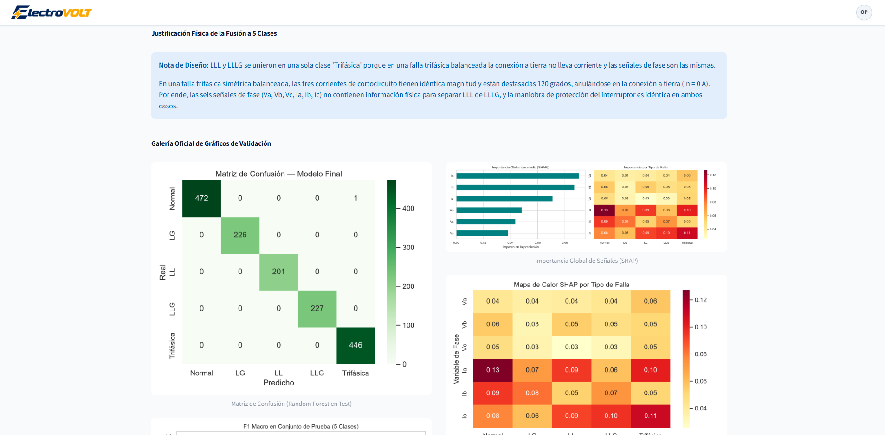

# Manual de usuario: ELECTROVOLT

**Proyecto integrador de maestría en Inteligencia Artificial**  
**Universidad de Especialidades Espíritu Santo (UEES) — 2026**  
**Autores:** Jordan Fabian Vera Coello y Jorge Rafael Estrella Frere

---

## 1. Guía paso a paso para usar la interfaz

La plataforma web ELECTROVOLT está diseñada para asistir a operadores de centros de control y cuadrillas de mantenimiento en el diagnóstico expedito de fallas en redes de distribución y transmisión.

### Requisitos previos de acceso
Para interactuar con la plataforma no se requiere instalar software especializado en la estación de trabajo:
* **Navegador compatible:** Google Chrome, Microsoft Edge, Mozilla Firefox o Safari en sus versiones recientes con soporte para WebGL y HTML5.
* **Resolución recomendada:** Pantallas de 1366x768 píxeles en adelante para visualización óptima de gráficos y paneles.
* **Modo de acceso:**
  * **Servidor en la nube:** Ingrese a la dirección oficial en Render: [https://electro-volt.onrender.com/](https://electro-volt.onrender.com/).
  * **Instalación local:** Ejecute en la terminal del proyecto `python -m streamlit run app/app.py` y abra en su navegador la URL local `http://localhost:8501/`.

---

### Navegación general de la plataforma
La interfaz utiliza una barra de navegación superior fija que permite alternar instantáneamente entre los tres módulos operativos principales y las páginas informativas:
1. **Diagnóstico en tiempo real:** Análisis interactivo mediante ajuste manual de magnitudes o plantillas de prueba.
2. **Diagnóstico desde archivo:** Procesamiento por lote de archivos de oscilografía en formato CSV.
3. **Auditoría del modelo:** Inspección de métricas de precisión, matrices de confusión y explicabilidad global.
4. **Menú de soporte e institucional:** Acceso directo a la descripción del sistema, políticas de privacidad y términos de servicio.

---

### Flujo de trabajo para diagnóstico individual en tiempo real

```
[Paso 1: Ingreso de señales] ➔ [Paso 2: Ejecución de inferencia] ➔ [Paso 3: Evaluación de criticidad] ➔ [Paso 4: Análisis SHAP] ➔ [Paso 5: Maniobra de despeje]
```

1. **Selección del método de carga de señales:**
   * **Opción A (Uso de plantillas preconfiguradas):** Despliegue el selector de ejemplos de prueba y elija uno de los cinco estados típicos de red: Régimen normal, Falla monofásica A-Tierra (LG), Falla bifásica B-C (LL), Falla doble fase a tierra B-C-G (LLG) o Falla trifásica simétrica A-B-C. El sistema poblará automáticamente los seis controles analógicos.
   * **Opción B (Ingreso manual analógico):** Utilice los deslizadores numéricos para introducir los valores instantáneos de las tres tensiones de fase $V_a, V_b, V_c$ en valores por unidad y las tres corrientes de fase $I_a, I_b, I_c$ en Amperios.
2. **Generación automática del diagnóstico:**
   * El modelo Random Forest procesa los datos en menos de 20 milisegundos y actualiza el encabezado de resultado con la clase de falla detectada, la probabilidad calculada y el nivel de certeza.
3. **Revisión del semáforo de criticidad y estado de fases:**
   * Observe el indicador luminoso: Verde para régimen normal, Amarillo para eventos monofásicos o bifásicos limpios, y Rojo para fallas severas a tierra o cortocircuitos trifásicos.
   * Verifique las etiquetas individuales de cada fase para confirmar qué conductores presentan sobrecorriente o colapso de tensión.
4. **Interpretación de la explicabilidad local con SHAP:**
   * Examine el gráfico en cascada que descompone qué magnitud eléctrica empujó la decisión del modelo hacia la clase identificada.
5. **Consulta de recomendaciones operativas:**
   * Lea las instrucciones técnicas recomendadas al final de la pantalla antes de autorizar maniobras de recierre o despacho de cuadrillas.

---

### Flujo de trabajo para procesamiento masivo por archivo CSV

```
[Paso 1: Descarga de plantilla] ➔ [Paso 2: Carga del archivo CSV] ➔ [Paso 3: Inferencia en lote] ➔ [Paso 4: Filtrado y exportación]
```

1. **Preparación y validación del archivo:**
   * Descargue el archivo de muestra disponible en el módulo para verificar que el encabezado contenga las seis columnas obligatorias: `Va, Vb, Vc, Ia, Ib, Ic`.
2. **Carga en la plataforma:**
   * Arrastre el archivo CSV al área de transferencia o presione el botón de exploración local.
3. **Ejecución del diagnóstico masivo:**
   * El motor procesará hasta 70,000 registros por segundo. La plataforma desplegará una barra de avance y confirmará la cantidad de muestras procesadas.
4. **Exploración de resultados:**
   * Revise las tarjetas estadísticas con el conteo y porcentaje de cada tipología de evento.
   * Utilice los filtros interactivos para aislar registros con fallas específicas o con niveles de confianza inferiores al 85%.
5. **Exportación de reportes:**
   * Presione **Exportar CSV clasificado** para descargar la base de datos con las columnas añadidas de diagnóstico, confianza y tiempo de inferencia.
   * Presione **Descargar reporte técnico** para generar el resumen consolidado de auditoría.

---

## 2. Capturas de pantalla anotadas

> [!TIP]
> **Instrucciones para visualizar tus imágenes en este manual:**  
> Guarda las capturas de pantalla de tu interfaz en formato PNG dentro de la carpeta `docs/images/` respetando los nombres de archivo indicados a continuación. Los visores de Markdown de GitHub, Visual Studio Code y navegadores cargarán las imágenes automáticamente mediante la ruta relativa.

---

### Captura 1: Consola de diagnóstico en tiempo real









#### Mapa de elementos anotados en pantalla
* **Zona 1 (Barra de herramientas superior):** Selector rápido de plantillas de oscilografía y botón de reinicio de valores a condición nominal de reposo.
* **Zona 2 (Bloque de controles analógicos):** Deslizadores de tensión $V_a, V_b, V_c$ acotados entre -0.65 p.u. y +0.65 p.u., y deslizadores de corriente $I_a, I_b, I_c$ acotados entre -900 A y +900 A con lectura digital instantánea.
* **Zona 3 (Tarjeta de diagnóstico y semáforo):** Caja destacada con la tipología de fallo detectada, porcentaje de confianza, tiempo de cómputo en milisegundos y semáforo de criticidad por color.
* **Zona 4 (Panel de integridad de fases):** Indicadores discretos que señalan si cada fase individual se encuentra en estado nominal, sobrecorriente o colapso de potencial.
* **Zona 5 (Gráfico de explicabilidad local SHAP):** Diagrama de barras horizontales que desglosa el aporte positivo o negativo de cada variable eléctrica a la decisión del algoritmo.
* **Zona 6 (Guía de maniobras de subestación):** Protocolo operativo sugerido para el despachador de carga, indicando si procede recierre manual, bloqueo preventivo o inspección de aislamiento.

---

### Captura 2: Módulo de procesamiento masivo por archivo CSV







#### Mapa de elementos anotados en pantalla
* **Zona 1 (Zona de carga y validación):** Contenedor interactivo para arrastrar archivos CSV y enlace de descarga de la plantilla oficial de datos.
* **Zona 2 (Tablero de distribución de perturbaciones):** Tarjetas métricas que cuantifican la cantidad total de eventos normales y fallas clasificadas por categoría física.
* **Zona 3 (Visor tabular dinámico):** Tabla de datos paginada con selector de tipo de falla, buscador de texto y ordenamiento por nivel de confianza.
* **Zona 4 (Barra de exportación):** Botones de descarga para obtener la base de datos enriquecida con etiquetas predictivas y el reporte técnico consolidado.

---

### Captura 3: Panel de auditoría técnica y métricas SMART





#### Mapa de elementos anotados en pantalla
* **Zona 1 (Panel de cumplimiento SMART):** Indicadores de exactitud global, F1 macro, sensibilidad mínima y brecha de sobreajuste comparados contra los umbrales fijados por la normativa del proyecto.
* **Zona 2 (Matriz de confusión multiclase):** Gráfico térmico normalizado que certifica la dominancia de la diagonal principal sobre las 1,573 muestras de prueba.
* **Zona 3 (Importancia global de señales):** Gráfico de impacto promedio SHAP donde se demuestra la relevancia de las magnitudes de corriente en la separación de fallas.

---

## 3. Explicación de cada funcionalidad

### Módulo de diagnóstico en tiempo real
* **Ingreso analógico de señales:** Permite ingresar magnitudes eléctricas continuas simulando lecturas de transformadores de potencial (PT) y corriente (CT). Los rangos están validados para evitar entradas incompatibles con la física del sistema.
* **Plantillas rápidas de oscilografía:** Cinco configuraciones predefinidas que replican transitorios típicos de campo, permitiendo a operadores noveles realizar demostraciones y comprobaciones sin necesidad de configurar manualmente seis deslizadores.
* **Clasificador predictivo multiclase:** Evalúa el vector de entrada con el paquete optimizado de Random Forest empaquetado en `models/best_model.pkl`, asignando una de las cinco clases físicas: Normal, Falla monofásica a tierra (LG), Falla bifásica (LL), Falla bifásica a tierra (LLG) o Falla trifásica simétrica.
* **Medidor de confianza y alerta de baja certeza:** Calcula la probabilidad marginal máxima entre las clases. Si la confianza es inferior al 70%, el sistema despliega una advertencia preventiva para sugerir verificación manual.
* **Detector de señales fuera de distribución (OOD):** Detecta magnitudes anómalas que exceden los límites físicos conocidos o lecturas compuestas exclusivamente por ceros, emitiendo una notificación de pérdida de señal de transductor.
* **Motor de explicabilidad SHAP:** Utiliza TreeExplainer para calcular los valores de Shapley locales, transformando un modelo de caja negra en un reporte auditable que explica qué fase causó el disparo.
* **Asistente operativo de maniobras:** Traduce la predicción de Machine Learning en instrucciones directas basadas en normas de operación de subestaciones, asistiendo al personal en la toma de decisiones.

---

### Módulo de diagnóstico desde archivo CSV
* **Validación sintáctica de archivos:** Verifica la estructura de columnas, el formato numérico de las celdas y la ausencia de valores nulos o corruptos antes de ejecutar la inferencia.
* **Inferencia masiva de alto rendimiento:** Aplica vectorización en NumPy y Scikit-Learn para evaluar registros oscilográficos a velocidades superiores a 70,000 muestras por segundo en CPU estándar.
* **Filtrado y exploración interactiva:** Permite al analista segmentar la oscilografía por tipo de perturbación detectada, identificando el momento exacto en que la red transitó de estado normal a falla franca.
* **Generador de reportes técnicos:** Exporta la información procesada a formatos abiertos para respaldo documental, auditorías regulatorias o integración con sistemas SCADA.

---

### Módulo de auditoría del modelo
* **Tablero de KPIs técnicos:** Presenta el resumen cuantitativo de exactitud (99.94%), puntaje F1 macro (0.9991), tiempo de respuesta (16.83 ms) y brecha de generalización (0.0006).
* **Comparador de arquitecturas:** Muestra el progreso experimental frente a los modelos baseline de regresión logística, perceptrón multicapa y máquinas de vectores de soporte.
* **Transparencia algorítmica:** Publica la ficha técnica del modelo con su fecha de entrenamiento, versión de librerías, hiperparámetros definitivos y balanceo de pesos.

---

## 4. Troubleshooting (problemas comunes y soluciones)

A continuación se detallan las incidencias más habituales durante la operación y los pasos requeridos para resolverlas:

| Incidencia detectada | Causa técnica probable | Solución paso a paso |
|---|---|---|
| **Error al cargar el archivo CSV:** *"El archivo no contiene las columnas requeridas"*. | Los encabezados del archivo no coinciden exactamente con la nomenclatura esperada (`Va, Vb, Vc, Ia, Ib, Ic`). | Abra el archivo en un editor de texto o Excel y renombre las columnas respetando mayúsculas y minúsculas. Alternativamente, descargue la plantilla vacía desde el módulo de carga. |
| **Alerta en pantalla:** *"Advertencia: Confianza de predicción inferior al umbral mínimo"*. | El vector de señales introducido se ubica en una frontera difusa entre clases o corresponde a un transitorio no contemplado en el entrenamiento. | Verifique que los valores de voltaje y corriente no provengan de un transductor descalibrado. Si los valores son correctos, mantenga el circuito desenergizado y solicite inspección física de campo. |
| **Notificación:** *"Posible pérdida de señal de transductores (lecturas en cero)"*. | Todas las corrientes y voltajes ingresados tienen valor cero o magnitudes cercanas a nulo. | Revise los fusibles de los transformadores de medida y el cableado del relé hacia la unidad terminal remota. |
| **La aplicación web no responde o muestra pantalla de reconexión.** | El servidor gratuito de Render entró en modo de suspensión por inactividad prolongada. | Espere entre 30 y 50 segundos mientras el contenedor se reactiva automáticamente y refresque la pestaña del navegador con F5. |
| **El gráfico explicativo SHAP no se visualiza en pantalla.** | Su navegador tiene deshabilitada la aceleración de gráficos por hardware o la versión de Javascript está bloqueada por extensiones de seguridad. | Verifique la configuración de aceleración por hardware en su navegador o desactive temporalmente extensiones de bloqueo de scripts para la página de la aplicación. |
| **La exportación a CSV genera un archivo sin extensión.** | El gestor de descargas del navegador eliminó la extensión `.csv` al almacenar el archivo. | Añada manualmente la extensión `.csv` al nombre del archivo descargado antes de abrirlo en su hoja de cálculo. |

---

## 5. FAQ (preguntas frecuentes)

### ¿Qué magnitudes físicas requiere el sistema para operar?
El sistema requiere exactamente seis variables instantáneas: tres voltajes de fase ($V_a, V_b, V_c$) expresados en valores por unidad respecto a la base nominal del alimentador, y tres corrientes de fase ($I_a, I_b, I_c$) expresadas en Amperios.

### ¿Por qué la plataforma clasifica en cinco clases en lugar de las seis que venían en Kaggle?
Porque desde el punto de vista físico de la teoría de componentes simétricas, un cortocircuito trifásico aislado entre fases (LLL) y un cortocircuito trifásico con contacto a tierra (LLLG) presentan impedancias idénticas y corrientes equilibradas de retorno nulo. Mantenerlas separadas generaba confusión algorítmica. Su unificación en la clase Falla trifásica simétrica resolvió el problema y elevó la confiabilidad al 99.94%.

### ¿Esta plataforma reemplaza los relés de protección física de la subestación?
No. ELECTROVOLT es un sistema de soporte a la decisión operativa y post-falla. Los relés electromecánicos o numéricos continúan a cargo de la apertura física ultrarrápida del interruptor. La plataforma clasifica la topología exacta del evento, explica las fases involucradas y asiste al despachador en los pasos posteriores a la perturbación.

### ¿Cómo debe interpretar un operador el gráfico SHAP?
Las barras de color hacia la derecha indican señales que aumentaron la probabilidad de la falla diagnosticada, por ejemplo una corriente anormalmente alta en la fase A. Las barras hacia la izquierda indican magnitudes que actuaron como atenuantes. Entre más larga sea la barra, mayor fue el peso de esa variable en el veredicto del modelo.

### ¿Es posible utilizar la plataforma de forma local sin conexión a internet?
Sí. El proyecto está construido con herramientas de código abierto. Puede clonar el repositorio, activar el entorno virtual de Python y ejecutar la aplicación de forma totalmente local y desconectada en la computadora de la subestación.

### ¿Qué se debe hacer si la certeza del diagnóstico es inferior al 70%?
El sistema no debe utilizarse para autorizar recierres automáticos si la certeza cae por debajo del 70%. En tales casos, el operador debe aplicar el protocolo de contingencia, revisar las oscilografías en el software propietario del fabricante del relé y coordinar una inspección visual con la cuadrilla de guardia.

---

## 6. Información de contacto para soporte

Para reportes de fallos en el software, sugerencias de mejora o consultas técnicas sobre la integración del modelo en subestaciones, comuníquese con el equipo de desarrollo a través de los siguientes canales oficiales:

### Equipo de desarrollo e ingeniería

* **Jordan Fabian Vera Coello**  
  * **Rol en el proyecto:** Product Owner, Machine Learning Engineer y Desarrollador Full-Stack  
  * **Responsabilidad:** Arquitectura de software, pipeline de datos, integración XAI con SHAP, desarrollo de la interfaz Streamlit y despliegue en la nube  
  * **Correo de contacto:** jordan.verac@uees.edu.ec
   * **Correo alternativo:** fabian112001ver@gmail.com

* **Jorge Rafael Estrella Frere**  
  * **Rol en el proyecto:** Tech Lead, Data Scientist y Experto de Dominio Eléctrico  
  * **Responsabilidad:** Validación física de perturbaciones en sistemas de potencia, análisis exploratorio, definición de umbrales operativos y coherencia de maniobras  
  * **Contacto:** jestrella@uees.edu.ec

---

### Canales institucionales y repositorio del código
* **Repositorio oficial de código fuente:** [https://github.com/Jordanfvc26/ELECTRO-VOLT](https://github.com/Jordanfvc26/ELECTRO-VOLT)
* **Gestor de incidencias y soporte técnico:** [https://github.com/Jordanfvc26/ELECTRO-VOLT/issues](https://github.com/Jordanfvc26/ELECTRO-VOLT/issues)
* **Servidor en producción de acceso libre:** [https://electro-volt.onrender.com/](https://electro-volt.onrender.com/)
* **Tiempo estimado de respuesta para solicitudes técnicas:** 24 a 48 horas laborables.
